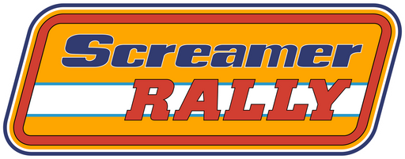
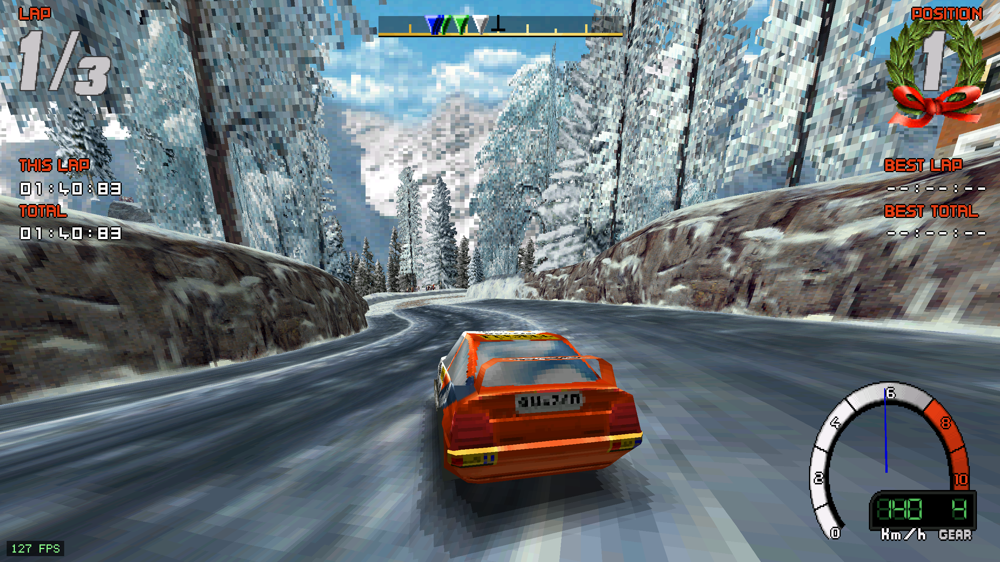
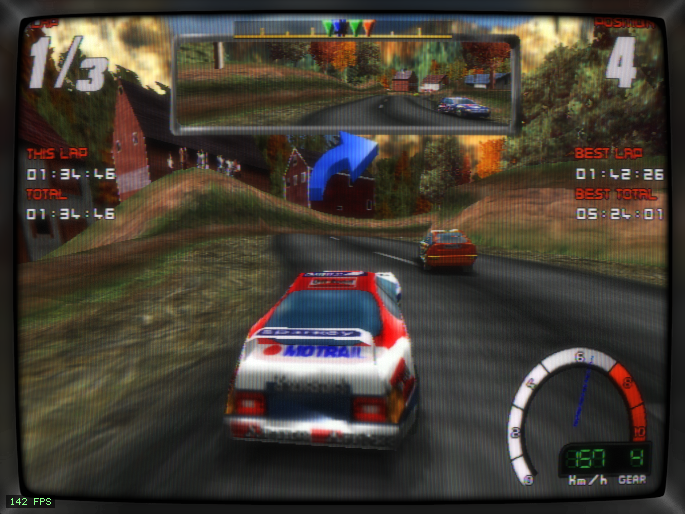

<p align="center">
  
</p>

<h3 align="center">The 1997 arcade rally classic, running natively on Windows 10 and 11</h3>

<p align="center">
  
  
  
  
</p>

<p align="center">
  <a href="https://github.com/Rick-Barber/ScreamerRally-Recomp/releases"><b>Download</b></a> ·
  <a href="#features">Features</a> ·
  <a href="#getting-started">Getting started</a> ·
  <a href="#how-it-works">How it works</a> ·
  <a href="#building-from-source">Building</a>
</p>

---

**Screamer Rally** (Milestone, 1997) was one of the great arcade racers of the MS-DOS and
3dfx era. This project brings it to modern Windows **without an emulator**: the game's own
32-bit x86 code runs directly on your processor, while everything it expected from a 1997
PC (DOS, the DOS/4GW extender, the BIOS, timers, the sound card, the CD drive and the 3dfx
Voodoo card) is reimplemented natively. The physics, the AI, the tracks, the cars and the
music are the original's, untouched; around them, a new renderer, widescreen, high frame
rates, controllers with vibration, CRT shaders and an in-game settings menu.

> [!IMPORTANT]
> No game data is included. You need your own copy of the original game: an image of the
> CD, or the DOS game installed on disk.

## Screenshots

<table>
  <tr>
    <td width="50%"></td>
    <td width="50%"></td>
  </tr>
  <tr>
    <td align="center"><sub>16:9 widescreen with the Claude Renderer</sub></td>
    <td align="center"><sub>CRT emulation, with the rear-view mirror</sub></td>
  </tr>
</table>

## Features

### The Claude Renderer
A new renderer that draws the 3D world from the game's own data, frame by frame, while the
look stays the 1997 one: the same models, textures, colours and cameras.

* **Your screen's full resolution**, up to 4K and beyond, with a render scale from 50 to 200 %.
* **Floating-point precision**: no wobbling polygons, no seams, no jittering textures close
  to the camera.
* **Full detail at any distance**: no simplified far cars and no cracks between track sections.
* **Correct overlaps** with a depth buffer, where the original sorted polygons and sometimes
  got it wrong.
* **Less pop-in**: the scenery the game shows from any part of the track in view is drawn,
  three times as far as the original.
* **Faithful details**: car windows, stickers and number plates in the right order, the
  water's reflections, shadows, dust and tyre marks no longer cut by bumps.
* **Camera collision**: the chase cameras stay in front of walls instead of cutting through them.
* The original 3dfx Glide drawing is still one setting away.

### Smooth and wide
* **High frame rates**: the game keeps simulating at the 33 steps per second its physics
  was tuned for, and the frames in between are interpolated, at your display's refresh rate
  or as fast as your PC allows.
* **Widescreen** that shows more of the track instead of stretching it, in any window
  shape or as 16:9, 21:9, 32:9 or the original 4:3; the menus' 3D scenes widen too.
* Windowed, borderless or exclusive fullscreen at any resolution and refresh rate
  (Alt+Enter switches).

### CRT emulation
* A port of [ShaderGlass](https://github.com/mausimus/ShaderGlass) built into the game, with
  **108 RetroArch CRT shaders** (crt-royale, crt-geom, crt-guest-advanced, crt-lottes,
  newpixie and more) applied to the game's own 480-line picture.
* Every shader parameter adjustable, favourites, search, profiles, snapshots and a
  hold-to-compare key.

### Day, night and fog
* Race any track by **day, at night or in fog**, and switch **live, in the middle of a race**:
  sky, lights, fog and headlights change on the spot. (In 1997, night and fog only came in
  some championship stages.)

### Controls
* **XInput controllers** (Xbox and compatible pads and wheels), plugged in at any time, with
  **analog steering, throttle and brake** through the game's own joystick code.
* **Vibration**, which the original never had: impacts, landings, the road surface and wheel
  spin, from what the game computes every step.
* Remappable buttons, dead zones, sensitivity and response curves; the controller works the
  menus too. The keyboard keeps the original controls.

### Comfort
* **In-game settings** (F12 or the controller's View button) over the paused game, applied
  at once.
* **Unlock all content** (tracks, championships, the bonus car) without touching your saves.
* **Autopilot**: Tab hands your car to the game's own AI.
* **CD music** played straight from the disc image, no drive needed, with its own volume.
* Sound effects mixed at the original 11 kHz or at full rate.
* A first-run window that finds your game: point it at a folder and play.

## Getting started

1. Download the latest release from the
   [Releases page](https://github.com/Rick-Barber/ScreamerRally-Recomp/releases) and unzip it
   into any folder.
2. Run **`ScreamerRally.exe`**.
3. The first time, click **Choose game folder…** and pick the folder with your copy of the
   game. It is checked, remembered, and the game starts.

**Your copy of the game** can be either:

| | What to pick | Music |
|---|---|---|
| **CD image** (Italian or English edition) | the folder holding the `.mds` + `.mdf`, or the `.cue` + `.bin`, or an `.iso` | from the CD's audio tracks (`.mds`, `.cue`); an `.iso` has none |
| **The DOS game installed on disk** | its folder with `STRT3FX.EXE`, `DATA` and `GFX` (also the version that runs without the CD) | none |

The game plays in the language of your copy (Italian or English). Your game files are only
read, never changed; settings, saves and replays are kept in the `data` folder next to the
program. The player guide (`README.md` in the package, [docs/USER_GUIDE.md](docs/USER_GUIDE.md)
here) describes every option.

**Requirements:** Windows 10 or 11 (64-bit) and a Direct3D 11 graphics card.

## Controls

| | Keyboard | Controller |
|---|---|---|
| Steer, accelerate, brake | arrow keys | left stick, right trigger, left trigger |
| Gear up / down | Right Shift / Ctrl | RB / LB |
| Camera | F1–F4, or C for the next one | Y or right stick click |
| Rear-view mirror | M | X |
| Autopilot | Tab | left stick click |
| Pause | Esc | Start |
| Settings | F12 | View / Back |
| Window ↔ fullscreen | Alt+Enter | |

## How it works

The original program, `STRT3FX.EXE` (the 3dfx Glide build), is a 32-bit protected-mode DOS
program. A small launcher prepares a 32-bit Windows process, loads the program's Linear
Executable image unchanged and runs it on the CPU. Everything the game expected from its
1997 environment is provided natively in Rust:

* **DOS, DPMI and the BIOS**: file, memory and interrupt services; the few privileged
  instructions and segment tricks are caught and answered by a trap layer.
* **Timers and interrupts**: the PC's timer and interrupt controller, paced in real time.
* **Sound**: the HMI SOS sound library is replaced by a native mixer (WASAPI).
* **CD-ROM**: MSCDEX and the CD's audio tracks, read from your disc image.
* **Graphics**: the 3dfx Glide 2 API on Direct3D 11, and the Claude Renderer, which reads
  the world, models, textures and transforms from the game's memory and draws them itself.
* **Executable profiles**: every patch and hook is tied to the exact executable (by its
  SHA-256) and checks the original bytes before it changes anything.

The reverse-engineering notes are in [docs/re/strt3fx.md](docs/re/strt3fx.md) and
[docs/re/native/](docs/re/native/); the approach in [docs/02-architecture.md](docs/02-architecture.md).

## Building from source

Requirements: Windows 10/11, Visual Studio 2022 (C++ build tools) and Rust (stable) with the
32-bit target:

```powershell
rustup target add i686-pc-windows-msvc
cargo build --release
```

The workspace builds for `i686-pc-windows-msvc` by default (`.cargo/config.toml`): the
original code is 32-bit, so the program is a 32-bit process. The executable is
`target\i686-pc-windows-msvc\release\ScreamerRally.exe`.

CRT emulation needs its shader library next to the executable, generated from a
[ShaderGlass](https://github.com/mausimus/ShaderGlass) source checkout (its generated
headers; nothing in it is built or run):

```powershell
.\target\i686-pc-windows-msvc\release\srtool.exe crt-pack <ShaderGlass folder> target\i686-pc-windows-msvc\release\crt-shaders.pak crt
```

**Packaging:** `powershell -ExecutionPolicy Bypass -File tools\package.ps1` builds the
release and creates `dist\ScreamerRally-<version>.zip` with the program, the player guide,
the licence, a notice and the CRT shader library (from `$env:SHADERGLASS` or
`work\thirdparty\ShaderGlass`).

<details>
<summary><b>Command line and diagnostics</b></summary>

| Option | Meaning |
|---|---|
| `--disc PATH` | the game for this run: a CD image (`.mds`, `.cue`, `.iso`) or the installed game's folder; not remembered |
| `--data DIR` | folder for settings, saves and the game's drive C: (default: `data` next to the exe) |
| `--filter nearest\|bilinear\|game` | texture filtering (default `nearest`) |
| `--fullscreen` | start in borderless fullscreen |
| `--aspect auto\|16:9\|21:9\|32:9\|4:3` | the picture's shape |
| `--input auto\|keyboard\|controller` | input mode for this run |
| `--keys "t:KEY,..."` | scripted keyboard input, e.g. `"12:ENTER,40:UP+,50:UP-"` |
| `--pad "t:INPUT,..."` | scripted controller, e.g. `"40:RT=1,45:LX=-0.5,47:LX=0,50:A"` |
| `--seconds N` | stop after N seconds and log statistics |
| `--dump-frames DIR[,N]` | save every N-th frame as PNG |
| `--log info\|debug\|trace` | log detail (`logs\runtime.log` next to the exe) |

Diagnostic environment variables: `SR_DETERMINISTIC=1` (virtual time: a scripted run
repeats exactly), `SR_AUTOPILOT=1`, `SR_SHOT=DIR,EVERY[,FIRST,LAST]` (presented frames as
PNG), `SR_TRACE_EVERY=N` (every Glide call of every N-th frame), `SR_STATE_TRACE=FILE` /
`SR_STATE_DUMP=DIR,FRAME` (game memory per frame), `SR_NATIVE=0|1` (the renderer),
`SR_INTERP=0|1`, `SR_DEPTH=0|1`, `SR_DETAIL=0|1`, `SR_PRECISE=0|1`, `SR_VISIBILITY=0|1`,
`SR_CONDITION=0..3`, `SR_DRAW_DISTANCE=N`, `SR_SAMPLE=1` (sampling profiler),
`SR_DUMP_WORLD=DIR` (the loaded world as OBJ), `SR_RUMBLE_LOG=FILE` (vibration),
`SR_NO_LAUNCHER=1`. The topic documents in `docs/re/` describe the rest.

</details>

## Repository layout

| Path | Content |
|---|---|
| `apps/screamer` | `ScreamerRally.exe`: launcher, game host, settings, first-run window |
| `apps/srtool` | developer tool: disc images, the game's `.DAT` archives, the executable (`dis`), the CRT shader pack |
| `crates/sr-runtime` | loader, trap layer, DOS/DPMI/BIOS/MSCDEX, timers, Glide, executable profiles, the Claude Renderer's extraction side |
| `crates/sr-render` | window, Direct3D 11 Glide pipeline, the Claude Renderer, the settings overlay |
| `crates/sr-scene` | the scene description the renderer draws |
| `crates/sr-crt` | CRT emulation: ShaderGlass's shader runtime, ported |
| `crates/sr-audio` | WASAPI output and mixer (CD music, sound effects) |
| `crates/sr-input` | XInput controllers: mapping, dead zones, curves, vibration |
| `crates/sr-disc` | disc images (MDS/MDF, CUE/BIN, ISO), ISO 9660, the game's `.DAT` archives |
| `crates/sr-le` | Linear Executable parser and relocator |
| `docs` | architecture, reverse-engineering notes, the player guide |

## Legal

This project contains **no part of the original game**: no game data and no executables. It
runs the copy you provide and never modifies it.

*Screamer Rally* and its logo are © 1997 Milestone / Virgin Interactive; this project is not
affiliated with or endorsed by them.

The code is released under the **GNU General Public License v3.0** ([LICENSE](LICENSE)). CRT
emulation is a port of [ShaderGlass](https://github.com/mausimus/ShaderGlass) by mausimus
(GPL-3.0); the shader library holds the
[libretro slang-shaders](https://github.com/libretro/slang-shaders), each under its authors'
licence.

## Credits

* **Milestone**, for the original game.
* **mausimus**, for ShaderGlass, and the libretro shader authors.
* Developed with [Claude Code](https://claude.com/claude-code).
